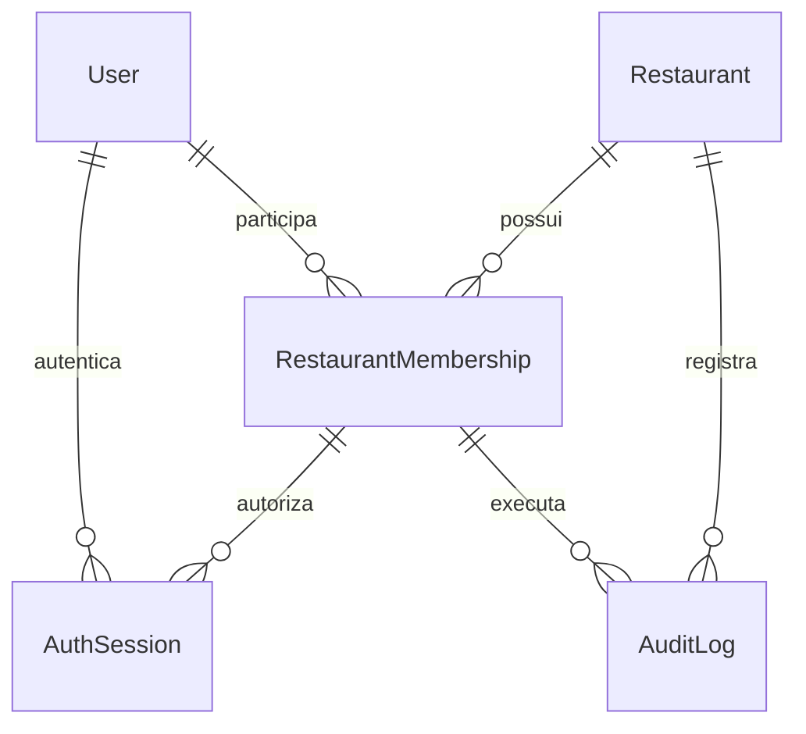

# Arquitetura — fundação

## Decisão inicial

Monólito modular Next.js: uma aplicação TypeScript fornece páginas e rotas REST, com Prisma e PostgreSQL centralizados. A primeira fase evita microsserviços e uma infraestrutura de eventos sem fluxos operacionais implementados. Endpoints financeiros e de pedidos deverão ser extraídos para serviços de domínio transacionais antes de adicionar as interfaces correspondentes.

## Modelo implementado

`RestaurantMembership` é único por restaurante/usuário. `Role` é um enum; a matriz de permissões é código versionado em `src/lib/permissions.ts`, não um gerenciador de políticas editáveis. `LoginAttempt` armazena o hash do e-mail, contador e início da janela; nenhuma senha é registrada. A relação composta da auditoria impede atribuir um autor de outro restaurante.

## Fluxos disponíveis

1. O comando administrativo cria usuário, restaurante, vínculo OWNER e auditoria em uma transação.
2. Login valida a origem, corpo, formato e taxa de tentativas; verifica a senha e o vínculo ativo no restaurante informado.
3. O servidor cria um token aleatório de 256 bits, persiste somente seu hash e envia o token em cookie HttpOnly.
4. Cada requisição autenticada verifica validade da sessão, vínculo, usuário, restaurante e papel. O tenant vem exclusivamente desse vínculo.
5. Edição do restaurante aceita apenas `name`. A atualização e a auditoria ocorrem na mesma transação.
6. Logout remove a sessão do banco e expira o cookie.

## Contrato REST atual

| Método e rota | Autorização | Comportamento |
| --- | --- | --- |
| POST `/api/auth/login` | Pública, origem validada | `{ restaurant, email, password }`; cookie de sessão |
| POST `/api/auth/logout` | Cookie, origem validada | Revoga a sessão atual |
| GET `/api/restaurant` | Qualquer vínculo ativo | Dados do restaurante da sessão |
| PATCH `/api/restaurant` | Proprietário/gerente, origem validada | Atualiza apenas `{ name }` e registra auditoria |
| GET `/api/members` | Proprietário/gerente | Até 100 vínculos do próprio restaurante, sem hashes de senha |
| GET `/api/health` | Pública | Disponibilidade da conexão PostgreSQL |

Respostas de erro: 400 validação, 401 não autenticado, 403 origem/permissão, 413 tamanho, 415 formato, 429 limite, 500 erro interno. A interface mantém mensagens de erro e confirmação específicas.

## Fronteiras das próximas fases

- Administração: categorias, produtos, adicionais, mesas, tablets e terminais; restrições compostas de tenant em todas as relações.
- Tablet: credencial própria de dispositivo, escopo de mesa e sessão; nunca credencial de funcionário.
- Pedidos: preços históricos em centavos, snapshots de adicionais, idempotência e máquina de estados no servidor.
- Tempo real: eventos persistidos via outbox e transporte autenticado, com replay/reconexão; eventos não substituem o banco.
- Conta/pagamento: transações e bloqueio por conta, alocações, saldo confirmado e conciliação. Valores nunca confiados ao frontend.
- Plataforma: administrador Zappy separado dos papéis de restaurante; receita SaaS separada do consumo.

Essas entidades e serviços **ainda não existem** no schema desta entrega. Não foram criadas tabelas vazias para representar funcionalidades concluídas.
